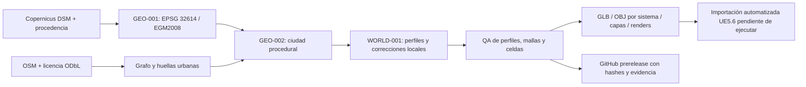

# Monterrey Open World

Mundo abierto georreferenciado de la Zona Metropolitana de Monterrey, México,
para **Unreal Engine 5.6.1 y Windows PC**. Prioridades: fidelidad geográfica, coherencia
visual y una base de mundo recorrible antes de incorporar tráfico, NPCs o misiones.

**Estrategia activa GEO-004: presupuesto US$0.** Visor web con Three.js y la
geometría real GEO-003; Unreal continúa como motor definitivo. No se autorizan
VM de pago ni servicios con cargos. [Visor, controles y publicación](docs/free001/README.md)
· **[Abrir WORLD-002](https://rawcdn.githack.com/DavrosMTY/MonterreySANDBOX/a44d909664914f088e01b23c87acb2ef8cab3c44/index.html)**
· [Identidad visual WORLD-002](docs/world002/README.md)
· [Capturas reales WORLD-002](https://rawcdn.githack.com/DavrosMTY/MonterreySANDBOX/a44d909664914f088e01b23c87acb2ef8cab3c44/evidence/index.html)
· [Descarga WORLD-002](https://github.com/DavrosMTY/MonterreySANDBOX/releases/tag/world002-b175978bcf0d)
· [Resultados FREE-001](docs/free001/RESULTADOS.md) · [Compatibilidad Unreal](docs/free001/ARQUITECTURA.md).

**[Abrir GEO-004](https://rawcdn.githack.com/DavrosMTY/MonterreySANDBOX/eff5f62d9634f7282071a8a40a46ab4b510811d6/index.html)** ·
[Capturas comparativas reales](https://rawcdn.githack.com/DavrosMTY/MonterreySANDBOX/eff5f62d9634f7282071a8a40a46ab4b510811d6/evidence/index.html)

**GEO-004 — auditoría topográfica y nuevo MDT INEGI 5 m:**
[Diagnóstico, reconstrucción y límites](docs/geo004/README.md) ·
[Fuentes oficiales](docs/geo004/FUENTES.md) · [QA](docs/geo004/RESULTADOS.md).
La geometría original y WORLD-002 permanecen disponibles. El nuevo MDT es de 2007,
con EPV no publicada: no se certifica precisión absoluta ni conducción del mundo.

**Referencia conservada: GEO-003 / WORLD-001 — graybox candidato para integración.** El piloto
cubre 2 × 2 km del centro, con 1.136 edificios, 2.665 tramos OSM y 1.077.198
triángulos. Se han generado y revisado imágenes reales en Blender. La entrega
local GEO-003 pasó 72 pruebas y QA de GLB/407 OBJ; la suite incorpora además cinco
pruebas de publicación GitHub y portabilidad. Unreal/Windows no se compiló ni ejecutó.

[Pull Request #1](https://github.com/DavrosMTY/MonterreySANDBOX/pull/1) ·
[Diagnóstico técnico](docs/GEO003_DIAGNOSTICO.md) ·
[Fuentes y licencias](DATA_LICENSES.md) ·
[Releases descargables](https://github.com/DavrosMTY/MonterreySANDBOX/releases) ·
[Validación CI](https://github.com/DavrosMTY/MonterreySANDBOX/actions)

## Objetivo y alcance actual

El objetivo del juego es recrear Monterrey a escala 1:1. El piloto utiliza
**1 metro de cuadrícula UTM = 100 unidades Unreal**; la proyección conserva su
pequeña deformación respecto a distancias geodésicas. No es todavía una recreación
completa de la metrópoli ni un videojuego jugable validado.

| Hito | Implementación disponible |
| --- | --- |
| GEO-001 | Adquisición con procedencia, DEM georreferenciado, PNG16/R16/GeoTIFF, tiles y extracción OSM |
| GEO-002 | Edificios con patios, alturas etiquetadas, vías por nivel, GLB y OBJ/MTL, renders y QA geométrico |
| GEO-003 / WORLD-001 | Perfiles viales conjuntos, capas topográficas reversibles, terreno recortado, túneles y exportación por sistema/celda |
| FREE-001 / WORLD-002 | Visor web real, streaming, materiales PBR procedurales, mobiliario, vegetación, DEM regional y comparación Graybox; validación en Chromium |
| GEO-004 | MDT INEGI LiDAR 5 m, transformación vertical explícita, plataformas sobre planos nativos, auditoría completa y visor comparativo |
| Integración UE5.6 | Proyecto C++, importadores, colisión estática, DataAsset, World Partition y sondas preparados; sin ejecución en motor |

Los perfiles motorizados se limitan al 8–12 % por categoría. Aun así, **97 tramos
motorizados requieren refinamiento geométrico**; uno llega a 15,52 % al muestrear
la superficie exportada. Hay cruces con superficies ausentes y un déficit nominal
de separación registrado. Esos tramos quedan excluidos de una ruta candidata de
1,498 km con 130 sondas de prueba. No se certifica conducción del mundo completo.

## Arquitectura



| Directorio | Responsabilidad |
| --- | --- |
| `GeoPipeline/` | GIS, adquisición, topología OSM, edificios, vías, terreno y QA |
| `Unreal/MonterreyOpenWorld/` | Proyecto, módulo runtime, plugin editor e importación Python |
| `tools/` | Entorno, aceptación, render, empaquetado y publicación GitHub |
| `tests/` | Regresiones GIS/3D y garantías de publicación sin sobrescrituras |
| `Data/` | Sólo el piloto pequeño y legalmente revisado se versiona; modelos generados se ignoran |
| `manifests/` | Inputs con hashes, referencias históricas y política de almacenamiento |
| `docs/` | Diagnósticos, decisiones, fuentes, arquitectura UE y resultados |
| `.github/` | CI, plantilla PR y sincronización inicial mediante Actions |

Contrato de coordenadas: EPSG:32614 y alturas EGM2008 sin conversión silenciosa.
Internamente ENU en metros; glTF X este/Y arriba/Z sur; Unreal X este/Y sur/Z arriba,
centímetros y pivotes locales por celda. El DSM nativo de ~30 m se muestrea en una
cuadrícula más fina: eso no crea resolución real adicional. Las correcciones,
alturas estimadas, anchuras y detalles genéricos se identifican como procedurales.

WORLD-001 utiliza terreno estático excavado. Importar el Landscape original sin
recortar cerraría los túneles y reintroduciría terreno dentro de calzadas.

## Reproducción automática

El supervisor no necesita ejecutar estos pasos; son instrucciones para agentes y
CI. Python 3.12, versiones fijadas en `requirements.lock.txt`, Blender para renders
reales y ningún servicio persistente. Desde la raíz del checkout Linux:

```bash
bash tools/setup.sh
.venv/bin/python tools/check_publication.py
.venv/bin/python tools/run_geo003.py
```

El runner crea una salida nueva con modelo, JUnit, QA, ruta candidata, recibo UE y
renders Cycles CPU. También se puede ejecutar `tools/run_geo002.py`. Los generadores
rechazan directorios de salida no vacíos y no sustituyen datos reales por fixtures.
En CI se usa `python`; la matriz valida Python en Linux y Windows sin compilar UE.

Para comprobar entregables ya retenidos en el entorno original:

```bash
.venv/bin/python tools/run_geo003.py --city-existing Data/city/geo003_world001 --renders-existing artifacts/geo003_renders
```

La aceptación distingue `offline_acceptance_passed_with_world_refinement_required`
de una aprobación de juego. Los scripts UE generan un recibo `blocked` (salida 2)
cuando faltan editor/toolchain. No hay certificados de cooking, física, cápsula,
streaming, Nanite, Lumen, PCG o HLOD ejecutado dentro del motor.

## Entregables desde GitHub

El código y el piloto se descargan desde la rama `development` o su ZIP de código.
Los modelos grandes, ZIP y renders se publican como assets de una **prerelease**
`geo003-world001-<commit>`, asociada al commit exacto y sin fusionar el PR.

La [prerelease GEO-003 / WORLD-001](https://github.com/DavrosMTY/MonterreySANDBOX/releases/tag/geo003-world001-3f5c050a07c6)
se reconstruyó en GitHub desde `3f5c050a07c6`. Se descargaron sus 11 assets y se
comprobaron SHA256, integridad de los tres ZIP y acceso público sin autenticación.
Evidencia en [el manifest de verificación](manifests/github-release-verification.json).

Assets publicados:

- `MonterreyOpenWorld_GEO001_pilot.zip`: inputs del piloto, avisos y manifest.
- `MonterreyOpenWorld_GEO002.zip` y `MonterreyOpenWorld_GEO003_WORLD001.zip`: código,
  modelos, fuentes del piloto, evidencia y licencias.
- `Monterrey_WORLD001.glb`, escena `.blend` y tres PNG reales.
- `release-manifest.json`, `SHA256SUMS.txt` y `DATA_LICENSES.md`.

Las reconstrucciones tienen sus propios hashes y recibos. Las referencias de los
ZIP históricos locales se conservan en manifests; no se afirma identidad binaria.
La matriz de Python 3.12 aprobó 77 pruebas tanto en Linux como en Windows; la
reconstrucción real de la Release también aprobó 77 pruebas y QA por hito.
Consultar [el recibo de sincronización](docs/GITHUB_SYNC_RESULTADO.md).

Se comprobó la política oficial: runners estándar gratuitos en repositorios
públicos; Releases admite 1.000 assets menores de 2 GiB por archivo y no limita
el tamaño total ni ancho de banda. No se usa LFS, caché persistente ni almacenamiento
de artifacts de Actions mientras sus cuotas de cuenta no estén verificadas.

## Desarrollo y revisión

GitHub es el repositorio principal. `development` incorpora el trabajo previo desde
el main existente; los avances posteriores se desarrollan mediante ramas, commits
y Pull Requests. Se conserva la restricción de Actions para crear o aprobar PR;
los agentes usan el acceso directo autenticado. No se reescribe el historial ni
se fusiona automáticamente.
Véanse [AGENTS.md](AGENTS.md) y [flujo GitHub](docs/GITHUB_WORKFLOW.md).

La sincronización conserva los archivos e historial locales. Se excluyen dependencias
instaladas, cachés, temporales, credenciales, modelos grandes y datos no revisados.
El piloto geográfico de ~7,7 MB está permitido bajo sus licencias y avisos adjuntos.
No se distribuye Unreal Engine ni assets comerciales. No se ha elegido una licencia
general nueva para el código del videojuego; las licencias de datos son separadas.

## Documentación

- [Auditoría GEO-003 y limitaciones](docs/GEO003_DIAGNOSTICO.md).
- [Integración y carpetas UE5](docs/world001/ESTRUCTURA_UE.md).
- [Rendimiento, HLOD e instancing](docs/world001/RENDIMIENTO.md).
- [Métricas de celdas](docs/world001/METRICAS_CELDAS.csv).
- [Resultados estructurados GEO-003](docs/GEO003_VALIDATION.json).
- [Histórico GEO-002](docs/GEO002_DIAGNOSTICO.md) y [GEO-001](docs/DIAGNOSTICO_GEO001.md).
- [Fuentes geográficas](docs/FUENTES_GEOGRAFICAS.md) y [avisos legales](DATA_LICENSES.md).
