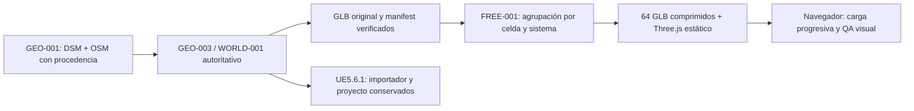

# FREE-001 — datos compartidos y automatización



## Contrato de datos

El GLB original está en la Release `geo003-world001-3f5c050a07c6`. Se descarga su
ZIP existente y se valida contra el manifest de verificación ya versionado antes
de extraer únicamente el manifest GEO-003 y su GLB. No se ejecuta código del ZIP ni
se extraen rutas arbitrarias. También se acepta el directorio original local,
comprobando su hash, hito, synthetic=false, CRS y datum.

- GIS interno: ENU en metros, EPSG:32614 / EGM2008.
- GLB y web: X este, Y arriba con altura EGM2008, Z sur, metros. Se aplican los
  transforms originales antes de reagrupar; pivotes locales mantienen precisión.
- Unreal: X este, Y sur, Z arriba, centímetros. El importador UE conserva su
  conversión existente; no se reutiliza un transform web como si estuviera en cm.
- Escala: un metro de cuadrícula UTM = una unidad web = 100 unidades Unreal;
  la pequeña deformación de proyección sigue documentada.

No se tocan `GeoPipeline/`, inputs licenciados, mallas originales ni `Unreal/`.
El desarrollo FREE-001 parte de development; PR #2 conserva por separado UE-001
(`82464719ac658f3a7932c94ee791ea43c2a90b06`), sin fusionarse ni revertirse.
Las preparaciones UE no equivalen a compilación/importación/ejecución del motor.

## Transformación web reproducible

`tools/build_web_viewer.py` agrupa las 2673 piezas originales en 64 sectores de
250 m y 279 mallas por sistema. Mantiene triángulos, posiciones, colores y todas
las fichas originales. Utiliza posiciones float32 relativas a celda, RGBA8
normalizado e índices uint16 cuando caben; conserva uint32 en caso contrario.
No decima, triangula de nuevo, cambia el trazado ni genera proxies de edificios.
Gzip determinista reduce transferencia sin perder geometría.

`world.json` contiene georreferencia, conteos, hashes, bounds y tamaños por sector.
`assets/features.json` conserva la ficha exacta de cada pieza original y el rango
de triángulos dentro de cada grupo: IDs, procedencia, sistema, celda y datos
procedurales siguen disponibles para inspección futura. No se descarga ese catálogo
completo en la navegación normal. Los archivos UE/OBJ originales siguen siendo
el camino autoritativo para importar Unreal, no la versión agrupada web.

`tools/validate_web_viewer.py` reabre cada GLB, recompone transforms y compara
**todos** los vértices, índices, colores y fichas fuente. No basta con contar
archivos. El máximo tolerado de redondeo es 0,1 mm; la entrega medida quedó muy
por debajo. Los generadores rechazan directorios ya existentes para preservar
resultados anteriores.

## Aplicación y memoria

Three.js se fija en package-lock y sus módulos/MIT se copian al sitio. No hay CDN
de librerías en runtime, fonts remotas, API de mapas ni backend. Sólo el hosting
sirve HTML/CSS/JS, manifest y payloads estáticos. En la vista temporal, el CDN
redirige los GLB gzip al mismo repositorio/SHA en raw.githubusercontent.com; el
navegador verifica su hash y CORS. No se aceptan otros destinos en el test.

El streaming se prioriza por distancia a los bounds de las celdas, permite dos
peticiones y evita adjuntar respuestas obsoletas después de cambiar de zona.
Descarga lo lejano con `dispose()` en geometrías y materiales. Pruebas unitarias
cubren bordes, descarga de sectores, respuestas tardías y fallos sin bucle de retry.
Los modelos comprimidos requieren DecompressionStream; SHA256 requiere HTTPS o
localhost seguro. Se muestra un error legible si falta WebGL 2 o esa capacidad.

Los FPS se calculan en una ventana móvil de dos segundos. La memoria de geometría
estima buffers de atributos/índices residentes; no incluye toda la GPU, framebuffer,
shaders o compositor. Heap JS se muestra como N/D si no existe performance.memory.
El modo alto usa sombras y requiere más recursos. El renderizador por software
se detecta cuando el navegador expone su nombre y comienza en calidad baja.

## Automatización con US$0

`.github/workflows/free001-web.yml` usa sólo un runner Ubuntu estándar público.
Instala dependencias fijadas, descarga la Release existente, transforma, verifica
contra el original, ejecuta pruebas JS y Chromium disponible, y publica assets
pequeños en `gh-pages` sólo ante el marcador explícito de la rama FREE-001. Un PR
ejecuta QA pero no publica. No hay backend ni nueva infraestructura.

La rama de hosting tiene un manifest de archivos generados. El publicador sólo
reemplaza archivos que él mismo registró y se niega a sustituir una rama ajena o
archivos inesperados; conserva commits previos y no usa force push. La captura
original de trabajo, caches y node_modules no entran en la rama de desarrollo.
La evidencia renderizada vive junto al sitio estático, no en Actions Artifacts.

El workflow de verificación pública visita un SHA inmutable del hosting, valida
la carga GLB, las vistas, teclado/mouse, errores y ausencia de servicios ajenos; sólo permite el hosting y la redirección
estática a los GLB del mismo repositorio/SHA. El aviso inicial del proveedor, que
puede incluir publicidad, se acepta por el botón normal y se audita separadamente
de los recursos de la aplicación. Guarda un recibo JSON en la rama de tarea. El navegador se lanza con
ANGLE SwiftShader explícito: son pruebas de software, no benchmarks de una GPU real.

La activación Pages queda registrada aparte del éxito de construir/publicar la
rama: un job que terminó sin errores no prueba que exista una URL Pages. Si GitHub
niega la configuración, se conserva ese bloqueo y se verifica por separado la
vista gratuita temporal. No se contrata ni activa otra alternativa de pago.

## Reproducción para agentes y CI

El supervisor sólo abre la URL; no ejecuta estos comandos. Una automatización usa:

```bash
npm ci --prefix WebViewer --no-audit --no-fund
.venv/bin/python tools/build_web_viewer.py --output artifacts/free001-new-site
.venv/bin/python tools/validate_web_viewer.py --site artifacts/free001-new-site
npm test --prefix WebViewer
```

Para las pruebas gráficas se ejecuta `WebViewer/tests/browser.mjs` con `MOW_SITE`
apuntando al sitio nuevo y `MOW_EVIDENCE` a otra carpeta nueva; usa Chromium instalado
sin bajar un navegador. `MOW_URL` permite comprobar el despliegue HTTPS real. Los
recibos no aprueban UHT/UBT, cooking, colisión ni gameplay de Unreal.
