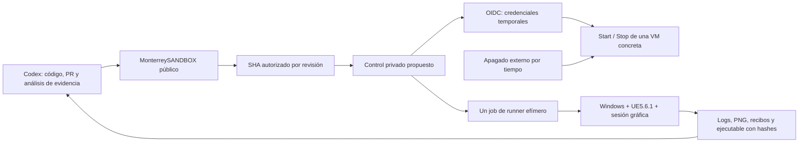

# INFRA-001 — conexión propuesta entre Codex, GitHub y Unreal

Diseño pendiente de aprobación y provisión. No hay VM, runner Windows ni acceso
cloud conectados actualmente. El entorno actual sigue siendo Linux, sin GPU
expuesta, con ~28 GiB libres; no permite certificar UE5.6.1 para Windows.

## Componentes y límites de confianza

1. **Repositorio público principal:** código, geodatos permitidos, documentación,
   PR y CI externa en runners estándar. Se conserva la restricción del propietario
   sobre creación/aprobación de PR por Actions. Codex usa su integración GitHub
   directa para PR; nadie fusiona automáticamente.
2. **Repositorio privado de control propuesto** (por ejemplo `MonterreyBUILD`):
   workflows mínimos revisados y acceso limitado al propietario/integración.
   No creado por INFRA-001. El repositorio público continúa siendo la fuente del juego.
3. **VM Windows dedicada al proyecto**, inicialmente AWS g4dn.2xlarge, en tenancy
   compartida del proveedor, sin exposición RDP/SSH a Internet. Windows Server 2022
   Desktop Experience, driver NVIDIA GRID/WDDM, UE5.6.1 y toolchain fijada.
4. **Almacenamiento:** 400 GiB EBS gp3 cifrado para motor, fuentes y cachés. Resultados
   de cada ejecución en carpeta nueva y almacén privado con retención explícita.
   NVMe local sólo para datos reconstruibles. No publicar una imagen del disco.

No registrar el runner GPU en el repositorio público. GitHub advierte que código
no confiable puede comprometer self-hosted runners públicos. Etiquetas o un `if`
en un workflow público no bastan como frontera. El control privado sólo ejecuta
`workflow_dispatch` sobre su rama protegida; no atiende PR de forks, eventos
`pull_request_target` ni `workflow_run` que descarguen y ejecuten código no aprobado.

## Identidades mínimas

| Identidad | Alcance propuesto | Exclusiones |
| --- | --- | --- |
| Codex / integración GitHub | Lectura de fuentes, ramas y PR en el proyecto; acceso seleccionado al control privado sólo tras autorización | Sin contraseñas del propietario ni claves cloud permanentes |
| Control de ciclo de vida | OIDC `aud=sts.amazonaws.com`; `sub` exacto del repositorio privado y entorno protegido; Start/Stop sobre ARN de una instancia identificada | Sin `RunInstances`, `PassRole`, cambio de tamaño, claves IAM ni acceso a otras VM |
| Descubrimiento del controlador | DescribeInstances/DescribeInstanceStatus/DescribeTags con condición de región y filtrado de ID/tags | Esas APIs Describe pueden requerir Resource `*`; no simular un ARN granular que AWS no acepte |
| Provisionador inicial | Rol temporal separado para recursos concretos y política revisada | No conceder ese rol al trabajo cotidiano; no existe aún |
| Broker de runners | GitHub App seleccionada sólo al control privado; administración de ese repositorio para registro; clave guardada en vault del controlador | La clave App no llega a la VM de Unreal ni al repo del juego |
| Runner de un trabajo | Token de registro temporal (~1 hora), configuración `--ephemeral`, permisos del job `contents:read` salvo necesidad documentada | Sin administración GitHub; no puede crear PR ni leer secretos del control |
| Perfil de la VM | SSM mínimo; lectura de inputs autorizados y escritura en prefijo privado de resultados del run | Sin administración cloud ni lectura global de buckets; IMDSv2 obligatorio |

Los tokens de instalación GitHub App y sesiones AWS expiran; no se imprimen ni se
incluyen en ZIP, logs o manifests. SSM Run Command queda restringido a documentos
de bootstrap revisados y la instancia concreta: enviar PowerShell arbitrario como
administrador es un permiso privilegiado y no debe disfrazarse de sólo lectura.

La integración actual no demuestra permiso para inventariar/registrar runners
(UE-001 recibió 403 en ese endpoint), ni acceso a un repositorio privado futuro.
Habrá que autorizar la App seleccionada y el rol OIDC en las consolas oficiales.
No solicitar PAT, contraseña, códigos MFA ni claves AWS en conversación.

## Arranque y sesión gráfica

1. Un job hosted breve valida aprobación, SHA, cuota y presupuesto restante, obtiene
   OIDC y arranca únicamente la instancia aprobada. Configura antes un guardián
   externo de apagado. No mantiene un runner hosted privado esperando seis horas.
2. Un bootstrap bajo SSM instala/verifica software desde fuentes oficiales y genera
   inventario. Los instaladores pesados sólo se descargan tras autorización.
3. Un usuario técnico local dedicado, sin privilegios administrativos cotidianos,
   abre una **sesión interactiva real**. El runner se lanza como proceso de esa sesión,
   no como servicio Session 0. Los servicios Windows no prueban por sí mismos una
   ventana D3D12 ni una captura del juego.
4. El runner efímero ejecuta un único job para el SHA exacto aprobado, conserva la
   evidencia y se desregistra. La persistencia de la VM no equivale a aislamiento:
   se separan workspaces y se revisan cambios al software base antes de reutilizarla.
5. Un job de cierre breve con condición `always()` detiene la VM. Además, el guardián
   externo debe actuar aunque fallen el agente, Windows o GitHub. Cancelar una
   ejecución no garantiza que se ejecute el cleanup; por eso hacen falta ambos.

La apertura automática de sesión al arrancar requiere una decisión inicial del
propietario sobre el modelo de seguridad y licencias. Si se autoriza, usar una
credencial de robot generada por vault y mecanismo Autologon/LSA con ACL estrictas,
**nunca la contraseña personal ni `DefaultPassword` en texto plano**. Un
administrador local puede recuperar el secreto LSA; es un riesgo real que debe
aceptarse para este diseño. El motor y los jobs no reciben la credencial del dueño.
Si no se autoriza ese mecanismo, habrá un desbloqueo gráfico humano por arranque,
o se cotizará un escritorio gestionado con sesión persistente.

DCV puede ayudar al diagnóstico, pero se habilita sólo después de confirmar
CAL/SAL y derechos Microsoft. Acceder por SSM no resuelve la licencia del editor;
una GPU virtual, un driver instalado y `-RenderOffscreen` tampoco demuestran que
la sesión renderice. La PoC comprobará adaptador/RHI, escena y PNG reales.

## Canal de ejecución del proyecto

El primer código candidato está en PR #2, commit
`82464719ac658f3a7932c94ee791ea43c2a90b06`. Puede probarse por SHA revisado sin
fusionar el PR. INFRA-001 no incorpora ni modifica ese código.

La herramienta
[`tools/run_ue001.py`](https://github.com/DavrosMTY/MonterreySANDBOX/blob/82464719ac658f3a7932c94ee791ea43c2a90b06/tools/run_ue001.py)
ya encadena validación externa, UBT Editor/Game, importación Python, World
Partition, prueba nativa, captura, UAT y lanzamiento del paquete. Sus APIs C++
y el importador aún pueden necesitar correcciones al ejecutarse por primera vez.
No existe un resultado compilado que permita prometer éxito al primer intento.

El workflow UE-001 publicado en su rama es una preparación. No debe conectarse tal
cual a un runner público privilegiado. El controlador privado se adaptará en una
nueva rama/PR revisable. GitHub sólo permite `workflow_dispatch` de workflows
presentes en la rama por defecto; no se anuncia el workflow de una feature como
un botón ya disponible. El control privado tendrá un workflow revisado en su rama
por defecto y descargará el **SHA aprobado**, no una rama mutable.

Cada job usa un checkout nuevo con ruta corta, por ejemplo `C:\mow\r\<run-id>`.
Las salidas van a otra carpeta nueva sin espacios. El importador rechaza assets
existentes: no repetir una importación completa sobre el proyecto ya poblado ni
borrar entregables anteriores para que pase. Conservar el workspace fallido y
crear uno nuevo para el siguiente intento. Reutilizar DDC separadamente reduce
shaders, sin mezclarlo con la evidencia ni versionarlo en Git.

La VM de 32 GiB es una reducción deliberada para una PoC económica frente a los
64 GiB preferidos en UE-001: una sola tarea a la vez, paralelismo de compilación
limitado inicialmente a dos procesos y espacio para pagefile. Los 400 GiB son una
hipótesis de capacidad que se comprueba antes de bajar el motor. Si aparece OOM o
falta de disco, parar y presentar evidencia/cotización de g4dn.4xlarge o mayor disco;
no escalar automáticamente. No compilar todo Unreal desde fuentes dentro del
presupuesto de seis horas.

## Evidencia, publicación y costos

Logs de UHT/UBT/UAT, Build.version, adaptador/RHI, mapa, nonce, PNG y hashes del
paquete se guardan bajo un identificador de ejecución y SHA de fuente. Recibos
independientes distinguen editor y ejecutable empaquetado. Un éxito de UAT no
sustituye lanzar ese ejecutable. Una imagen NullRHI o un render Blender no aprueba D/E.

Propuesta de entrega inicial: objetos privados cifrados con URLs de descarga de
vida corta, consumo y retención presupuestados dentro de la reserva. Tras revisar
licencias, secretos y tamaños, un build cocinado y sus evidencias pueden ir a una
prerelease GitHub (<2 GiB por asset, máximo 1000 assets). No subir motor sin cocinar,
SDK, instaladores VS, credenciales ni snapshots de la máquina. No usar LFS, cachés
persistentes o Actions Artifacts hasta comprobar cuotas aplicables.

El controlador privado hosted puede consumir minutos de su plan; mantenerlo breve
no significa que se haya comprobado su cuota. El runner self-hosted no añade cargo
de ejecución Actions según la fuente consultada, pero su VM sí factura.
Codex/API tampoco está incluido en la tabla de infraestructura.

Para la PoC: límite acumulado de seis horas de instancia encendida, bloqueo de
nuevos arranques al consumirlo, guardián con vencimiento y registro del Stop real.
Alertas de AWS Budgets **no son un límite duro de gasto**. Disco y otros recursos
retenidos siguen cobrando; la retención de 30 días exige revisión y decisión
explícita antes de renovarse o destruir recursos nuevos. No borrar trabajo existente.
